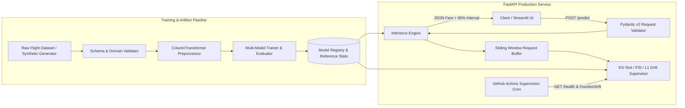

# Flight Fare Prediction Service

[](https://github.com/Rahul-git64/flight-fare-prediction/actions/workflows/ci.yml)
[](https://github.com/Rahul-git64/flight-fare-prediction/actions/workflows/cd-deploy.yml)
[](https://github.com/Rahul-git64/flight-fare-prediction/actions/workflows/supervision-cron.yml)
[](https://www.python.org/downloads/)
[](https://fastapi.tiangolo.com)

An end-to-end machine learning system for estimating domestic flight fares across major Indian metropolitan routes. The service combines automated multi-model training and selection, a FastAPI inference engine with Pydantic v2 validation, a Streamlit operator dashboard, and statistical data drift supervision using the two-sample Kolmogorov-Smirnov (KS) test and Population Stability Index (PSI).

---

## System Architecture



---

## Key Engineering Features

- **Strict Schema & Domain Validation:** Normalizes legacy column names (`classs` / `class` to `travel_class`), enforces positive flight durations and valid lead-time windows, and prevents identical origin/destination city pairs.
- **Resilient Feature Pipeline:** Uses `ColumnTransformer` with median/mode imputation, `MinMaxScaler` for continuous features (`duration`, `days_left`), and `OrdinalEncoder(handle_unknown="use_encoded_value", unknown_value=-1)` for categorical features.
- **Automated Model Selection:** Evaluates `LinearRegression`, `Ridge`, `Lasso`, `ElasticNet`, `DecisionTreeRegressor`, `RandomForestRegressor`, and `GradientBoostingRegressor`, persisting the best estimator by holdout $R^2$ along with 90th-percentile residual prediction intervals and reference training distributions.
- **Built-In Production Supervision:**
  - `GET /health`: Reports service status, uptime, active model metadata, and holdout validation metrics ($R^2$, RMSE, MAE).
  - `POST /predict`: Validates itinerary inputs, logs structured JSON latency (`latency_ms`) and confidence scores, and returns estimated fares in INR.
  - `GET /monitor/drift`: Evaluates numerical feature drift via two-sample Kolmogorov-Smirnov ($p < 0.05$) and Population Stability Index ($\text{PSI} \ge 0.25$), plus categorical $L_1$ distribution divergence against training baselines.

---

## Project Layout

```text
flight-fare-prediction/
├── .github/workflows/
│   ├── ci.yml                  # Ruff, pytest, Docker build & container smoke test
│   ├── cd-deploy.yml           # Publishes verified image to GitHub Container Registry
│   └── supervision-cron.yml    # Daily automated health & drift supervision check
├── configs/
│   └── config.yaml             # Central configuration for data, features, model & drift
├── scripts/
│   ├── entrypoint.sh           # Container startup and auto-bootstrap script
│   ├── streamlit_app.py        # Interactive Streamlit client and supervision UI
│   └── train.py                # CLI training pipeline entrypoint
├── src/flight_fare/
│   ├── api/
│   │   ├── main.py             # FastAPI application and route definitions
│   │   ├── monitoring.py       # KS-test, PSI, and categorical L1 drift supervisor
│   │   └── schemas.py          # Pydantic v2 request/response contracts
│   ├── core/
│   │   ├── config.py           # Typed YAML configuration loader
│   │   ├── exceptions.py       # Domain exception hierarchy
│   │   └── logger.py           # Structured JSON logger
│   ├── data/
│   │   ├── ingestion.py        # Dataset loader and synthetic fallback generator
│   │   ├── preprocessing.py    # Scikit-learn ColumnTransformer & reference stats export
│   │   └── validation.py       # DataFrame schema and constraint checks
│   └── models/
│       ├── registry.py         # Model artifact loader and runtime predictor
│       └── trainer.py          # Multi-model training and evaluation loop
├── tests/
│   ├── fixtures/
│   │   └── sample_flights.csv  # Lightweight fixture for fast CI test execution
│   ├── test_api.py             # FastAPI endpoint & drift progression integration tests
│   ├── test_data_pipeline.py   # Validation, ingestion & preprocessing unit tests
│   └── test_model_trainer.py   # Training pipeline & registry inference unit tests
├── Dockerfile
├── pyproject.toml
└── README.md
```

---

## Local Setup & Quickstart

### 1. Install Dependencies

```bash
pip install -e ".[dev]"
```

### 2. Run the Training Pipeline

```bash
python scripts/train.py
```

### 3. Launch the FastAPI Service

```bash
uvicorn flight_fare.api.main:app --host 0.0.0.0 --port 8000 --reload
```

Interactive Swagger documentation is available at `http://localhost:8000/docs`.

### 4. Launch the Streamlit Console (Optional)

```bash
streamlit run scripts/streamlit_app.py
```

### 5. Run Linter & Test Suite

```bash
ruff check .
pytest -v
```

---

## Docker Usage

### Build & Run Locally

```bash
docker build -t flight-fare-prediction:latest .
docker run -d --name flight-fare-api -p 8000:8000 flight-fare-prediction:latest
```

### Pull from GitHub Container Registry (GHCR)

```bash
docker pull ghcr.io/rahul-git64/flight-fare-prediction:latest
docker run -p 8000:8000 ghcr.io/rahul-git64/flight-fare-prediction:latest
```

---

## API Reference

### `GET /health`

```bash
curl -s http://localhost:8000/health | jq
```

```json
{
  "status": "healthy",
  "service": "flight-fare-prediction",
  "version": "0.1.0",
  "uptime_seconds": 42.18,
  "active_model": "GradientBoostingRegressor",
  "model_metrics": {
    "rmse": 742.19,
    "mae": 518.44,
    "r2": 0.9912
  },
  "buffered_requests": 6
}
```

### `POST /predict`

```bash
curl -s -X POST http://localhost:8000/predict \
  -H "Content-Type: application/json" \
  -d '{
    "airline": "Vistara",
    "source_city": "Delhi",
    "departure_time": "Morning",
    "stops": "zero",
    "arrival_time": "Afternoon",
    "destination_city": "Mumbai",
    "travel_class": "Business",
    "duration": 2.15,
    "days_left": 14
  }' | jq
```

```json
{
  "predicted_price_inr": 35840.25,
  "prediction_interval_inr": {
    "lower": 34810.10,
    "upper": 36870.40
  },
  "confidence_score": 0.9412,
  "model_name": "GradientBoostingRegressor",
  "model_version": "0.1.0",
  "latency_ms": 4.821
}
```

### `GET /monitor/drift`

```bash
curl -s http://localhost:8000/monitor/drift | jq
```

```json
{
  "status": "healthy",
  "overall_drift_detected": false,
  "sample_size": 12,
  "reference_size": 1200,
  "numerical_features": {
    "duration": {
      "ks_statistic": 0.1833,
      "ks_p_value": 0.7814,
      "psi": 0.0842,
      "mean_reference": 6.412,
      "mean_current": 5.925,
      "drift_detected": false
    },
    "days_left": {
      "ks_statistic": 0.15,
      "ks_p_value": 0.9102,
      "psi": 0.0619,
      "mean_reference": 25.104,
      "mean_current": 23.5,
      "drift_detected": false
    }
  },
  "categorical_features": {
    "airline": {
      "l1_divergence": 0.1417,
      "drift_detected": false
    }
  }
}
```

---

## License

Distributed under the MIT License.
